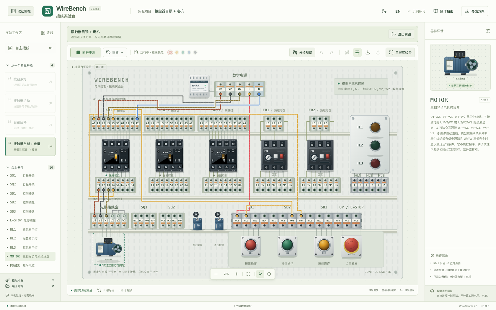

# WireBench 2D

[简体中文](README.md) · English

A two-dimensional electrical training bench in your browser. Device leads are already connected to terminal strips. Draw wires between terminals, operate buttons and switches, and watch contactors and indicator lamps respond to the circuit you build.

**Teaching release 3.1.0: [v3.1.0](https://github.com/EthanSky2986/WireBench-2D/releases/tag/v3.1.0) (2026-10-27).** Code uses the MIT license; the public repository excludes original reference images. The model supports basic control-circuit practice and three-phase motor wiring topology; it does not calculate physical voltage, current, or motor motion.



## Features

- 16 device definitions and 113 selectable terminals; refined artwork throughout the main bench and device inspector. Three lamps share a vertical panel and six-position terminal bank; SB controls align with their terminal groups.
- Four editable examples: button-controlled lamp, contactor jogging, self-holding start/stop, and self-holding contactor plus motor. An empty workspace supports independent wiring.
- A three-phase teaching supply and motor terminal box can be wired directly. The model checks the actual winding topology, defined supply relationships, and the presence of U/V/W before marking a Y or delta arrangement as meeting its run criteria; unsupported and undefined relationships are reported explicitly.
- Wire drawing, selection, colors, draggable bends, deletion, undo, and redo. New routes seek separate lanes; older routes can be arranged explicitly. Cycle overlapping wires; the selected wire stays clear with A/B endpoint marks.
- Optional **Step observation**: press and release buttons separately, review action snapshots and state changes, and keep tracing the supply and return paths of a chosen coil or lamp.
- Short-circuit and unstable-circuit messages, overload relay tests, emergency stop, and normally open/closed contact behavior.
- Complete Simplified Chinese and English interfaces, light/dark themes, a compact header, collapsible navigation, zoom, pan, and full screen.
- Browser-local autosave for your own workspace, validated JSON import, file export, and protection against overwriting damaged saved projects.

No account or backend is required. Installing dependencies needs internet access; core experiments use local resources afterward.

## Run locally

Download and extract the source from the [v3.1.0 release page](https://github.com/EthanSky2986/WireBench-2D/releases/tag/v3.1.0), or clone the repository. The application is available for local use after download; there is no hosted online demo.

Windows x64 users can download `WireBench-3.1.0-win-x64.exe` from the release page. Double-clicking it starts a local server and opens the default browser. The launcher listens only on `127.0.0.1:48173`; close its console window to stop the server. It does not require Node.js and is not an embedded desktop browser. The unsigned Windows file may trigger a SmartScreen warning; obtain it from the GitHub release page.

Install Node.js **22.12+** and npm; Node.js **24 LTS** is recommended. In the project directory:

```sh
npm ci
npm run dev
```

Open the address printed in the terminal, normally [http://127.0.0.1:5173/](http://127.0.0.1:5173/). Keep the terminal open while using the application; press Control+C to stop it.

On macOS, you can also double-click **启动实验台.command**. If macOS does not run it directly, right-click and choose Open, or run `zsh 启动实验台.command` in a terminal. The launcher also requires Node.js and npm.

## Your first experiment

1. Use the language icon to select **English**. Expand navigation and select **Self-holding circuit**.
2. Select **Power on**. The amber lamp indicates standby.
3. Press and release **SB2**: **KM1** energizes and holds; the green lamp stays on.
4. Press **SB1** to stop, or click **E-STOP** to latch the emergency stop. Click it again to reset; resetting alone does not restart the circuit.
5. Start again, then click **FR1’s TEST** to test a trip: the contactor releases and the red lamp lights. Click **RESET** to reset it; clicking the relay body only shows its details.
6. Select **Exit experiment** to restore the workspace you had before entering the example.

To observe the motor, select **Self-holding contactor + motor** and press and release SB2. The terminal box shows the model's running state only when all three windings have a defined supply path and U/V/W are all present. This is not a measured speed.

Examples contain ordinary wire data rather than preset simulation results. Turn off power, remove a necessary wire, and power on again: the result changes with the actual circuit.

For a closer look, enable **Step observation** in the toolbar. Click SB2 to press, then click again to release. Select KM1 in the inspector to compare the starting branch with the holding path that remains closed. Any coil or lamp can be inspected. Purple outlines identify valid supply and return paths, including parallel branches; they do not represent measured current.

History is read-only. Choose **Return to live run** before operating again. Leaving the window automatically releases momentary buttons and records the reason. Up to 120 actions are kept for the current wiring revision; rewiring, resetting, or refreshing clears them. Wiring undo history remains separate.

## Controls

| Action                     | How                                                                                                                                                                                  |
| -------------------------- | ------------------------------------------------------------------------------------------------------------------------------------------------------------------------------------ |
| Draw a wire                | With power off, click the starting and destination terminals; click empty space, an existing wire, or the device housing to add bends. Internal terminal screws are not bend targets |
| Cancel a pending wire      | Press Esc or use the cancel control                                                                                                                                                  |
| Adjust routing             | Select a wire and drag its circular bend handles; **Reroute wire** replans that wire and can be undone                                                                               |
| Arrange older routes       | **Arrange automatic wires** in the toolbar arranges only wires without a saved route; existing bends stay unchanged. Undo is available                                               |
| Identify overlapping wires | Click the same position repeatedly or select **Next wire**; the selected wire moves visually to the front and marks its endpoints while other ordinary wires dim                     |
| Change color / delete      | Select a wire and use the inspector; Delete also removes it                                                                                                                          |
| Undo / redo                | Toolbar, ⌘/Ctrl+Z, or ⌘/Ctrl+Shift+Z                                                                                                                                                 |
| Zoom / pan                 | Scroll to zoom; hold Space and drag, use the middle mouse button, or select the pan tool; **Fit bench to view** restores automatic fitting                                           |
| Momentary pushbutton       | Hold to activate and release to reset; focused buttons also support Space/Enter                                                                                                      |
| SQ, emergency stop         | Click to activate, click again to reset                                                                                                                                              |
| FR overload relay          | Body opens details; TEST trips, RESET resets. Current adjustment is not simulated.                                                                                                   |
| Reset operating state      | **Reset → Reset operating state** beside power; powers off and resets inputs and faults, retaining wiring and wiring undo history                                                    |
| Clear wiring               | **Reset → Clear all wiring**, then confirm; keeps the name and current exercise and can be undone                                                                                    |
| Exit an example            | Select **Exit experiment**, click the selected example again, or choose **My workspace**                                                                                             |
| Save / import / export     | Your own workspace autosaves; export from the toolbar or import a `.wirebench.json` file with power off                                                                              |
| Language / theme           | EN switches to English; 中 switches to Chinese; the appearance icon switches theme directly; both move to the toolbar in full screen                                                 |
| Full screen / navigation   | Enter full screen from the toolbar; Esc or the exit control restores it; navigation and its groups can collapse independently                                                        |

Full screen preserves the circuit and running state. Open the inspector from its toolbar to view contacts, change wire colors, reroute, or delete wires; wiring edits remain locked while powered. If native full screen is unavailable, the bench fills the page and displays a notice. The selected wire stays continuously visible while only its outer halo pulses; the system's reduced-motion preference disables that animation.

Wire crossings, overlaps, and routes passing over terminals do not connect them: only each wire's endpoints create an electrical connection. Small crossing gaps distinguish overlapping layers; they do not mean a broken wire. A/B mark endpoints, not current direction. Color, route, and fixed-lead visibility do not affect simulation.

## Saving and recovery

**Your own workspace** saves its name and wires in local storage for the current browser and address. Only one personal workspace is saved; multiple-project management and cloud sync are not available. Language and theme preferences are separate from project files. Undo/redo history does not survive a refresh.

**Examples are temporary exercises.** Entering one preserves your original workspace and history; exiting restores them. Switching examples starts from the new template. Exit or refresh discards practice changes, so export to keep them; the Save icon also exports in an example. Refresh returns to your saved personal workspace.

Successful import replaces your own workspace and exits any example. Undo can restore the previous wires; the name is not part of wiring history. Failed import preserves the current project. Damaged or unknown-version saved data is protected from overwrite; see [Architecture](docs/ARCHITECTURE.md#外部数据与版本) for recovery instructions.

Export has been verified locally to download an actual file with the correct name and complete wiring data; the full round trip through reimporting that file remains unverified. Check the browser's downloads and the actual file; the interface only reports that a download was requested.

## Model scope and known limitations

Devices include KM1–KM3 with LANN22 auxiliary contacts, FR1–FR2, SQ1–SQ2, SB1–SB3, an emergency stop, HL1–HL3, a single-phase control supply, a three-phase teaching supply, and a three-phase motor terminal box.

| Supported                                                                                                                                                            | Not simulated or not yet verified                                             |
| -------------------------------------------------------------------------------------------------------------------------------------------------------------------- | ----------------------------------------------------------------------------- |
| Ideal normally open/closed contacts, jogging, self-holding, stop circuits, and independent parallel loads                                                            | Physical voltage, current, coil ratings, frequency, and pickup thresholds     |
| Emergency stop when wired into a circuit; FR tests switch auxiliary contacts                                                                                         | Motor direction, speed and torque; temperature rise and thermal trip timing   |
| Three-phase supply and phase-to-phase short localization; the motor meets modeled run criteria only with defined supply paths through all windings and U/V/W present | Voltage division across series loads, current settings, and real trip curves  |
| Explicit short-circuit, unstable-circuit, and unsupported-arrangement messages                                                                                       | Real terminal wire capacity and engineering validation of physical wiring     |
| Core desktop-browser interactions tested locally                                                                                                                     | Full cross-browser coverage, touch/mobile use, and performance with 500 wires |

`POWER:L/N` and `POWER:U2/V2/W2` describe connectivity only: L/N is the single-phase control supply and U/V/W are three independent phase rails for the teaching circuit. They do not assume a physical voltage or measured current. The model's run criteria require supply paths through all three windings and all three phases U, V and W. Y and delta are wired by the user and are not modelled separately. Phase sequence, direction, speed, and a real motor's behavior, temperature, or torque during phase loss are not simulated. An FR test does not directly open its three-phase through paths; the emergency stop is not a global power switch. Unsupported arrangements produce a message; simulation results do not establish that physical wiring is safe.

Refined devices are in the main bench. **Rounded wires remain exclusive to the material study.** Open it through the sidebar or `/?preview=materials` after starting the app. The study runs independently without reading or writing your workspace. New main-bench wires seek clear lanes around devices and other wires, then keep their saved route. Opening older files does not move their wires. Dense wiring can still have crossings or short shared runs; see the [visual guidelines](docs/VISUAL_STYLE.md).

## Development and feedback

```sh
npm run check        # Format check, TypeScript/build, and all tests
npm run format       # Apply the shared code format
npm run preview      # Preview the existing production build; use the printed address
```

Reports should include the browser, reproduction steps, expected behavior, and actual behavior. Attach a `.wirebench.json` with personal information removed if needed. Please use [Issues](https://github.com/EthanSky2986/WireBench-2D/issues).

- [Contributing](CONTRIBUTING.md)
- [Changelog](CHANGELOG.md) · [Roadmap](ROADMAP.md)
- [Architecture](docs/ARCHITECTURE.md) · [Detailed development conventions](docs/CONTRIBUTING.md) · [Internationalization](docs/INTERNATIONALIZATION.md)
- [Visual guidelines](docs/VISUAL_STYLE.md) · [Theming](docs/THEMING.md)

Detailed architecture and development documents are currently in Chinese. The contribution guide, roadmap, and changelog provide English summaries.

## Repository and licensing status

The [GitHub repository](https://github.com/EthanSky2986/WireBench-2D) is open source as the `v3.1.0` teaching release. Project code and original documentation use the [MIT license](LICENSE). User-supplied photographs, sketches, product images, and their copies are excluded. README screenshots show the application itself; the terminal-layout reference is generated from code. See [third-party and reference-material notices](THIRD_PARTY_NOTICES.md) for dependency and material scope.

An independent classroom trial by a teacher or student remains pending. Follow the example steps above and report reproducible feedback; the current scope and limitations are described above.

`private: true` in `package.json` prevents accidental npm publication; it does not control GitHub visibility. Sharing source on GitHub does not require publishing an npm package.

## Support the project

If this project helps you, [optional donations](SUPPORT.en.md) are welcome. Bug reports, teaching suggestions, and code contributions are equally appreciated. No donation is required to use it.
